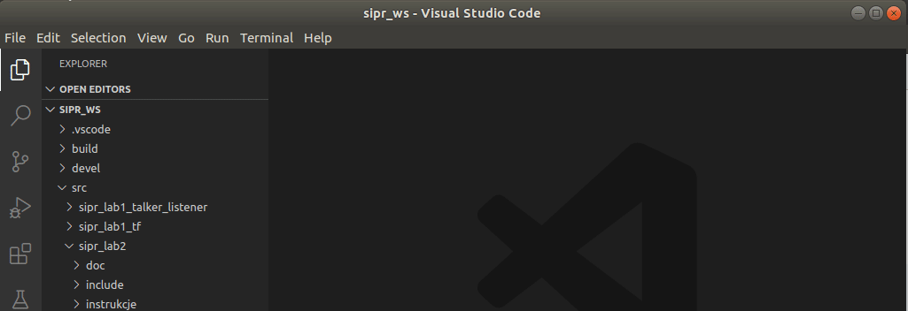
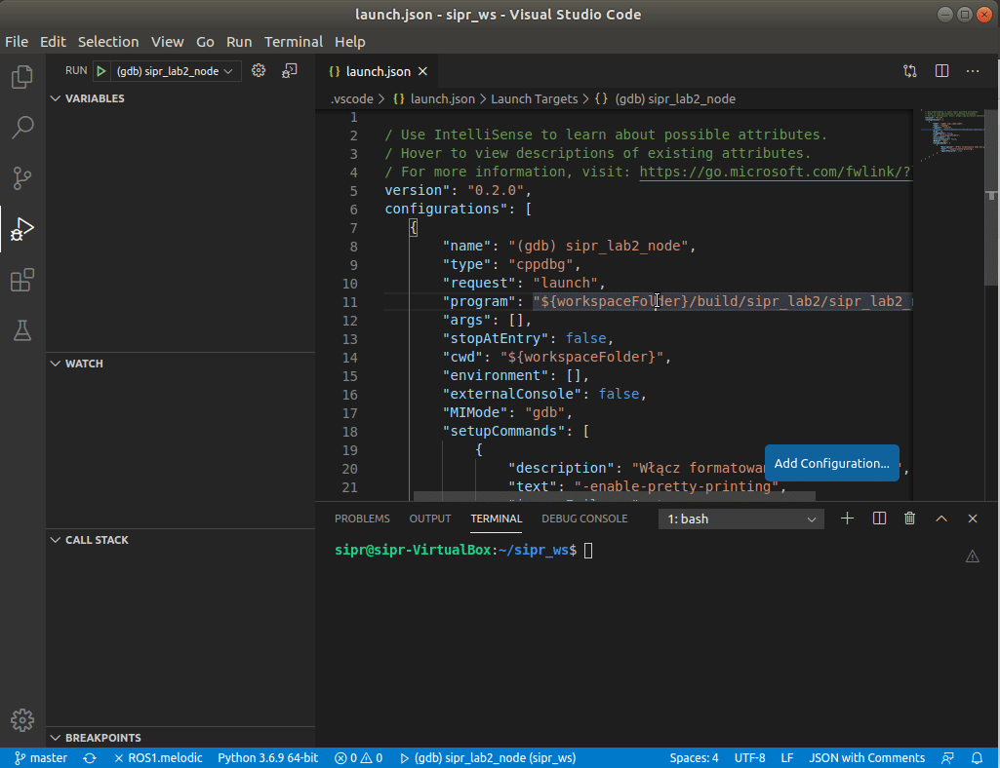
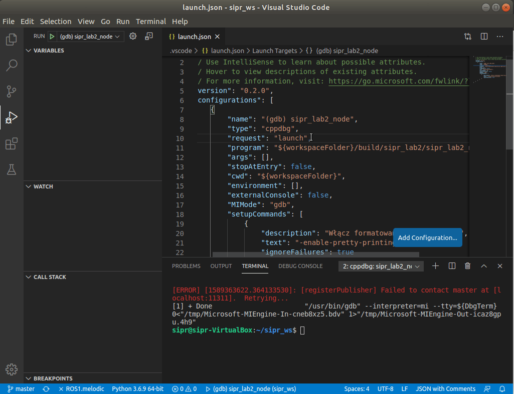
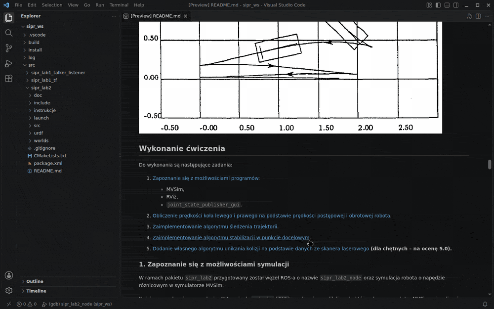
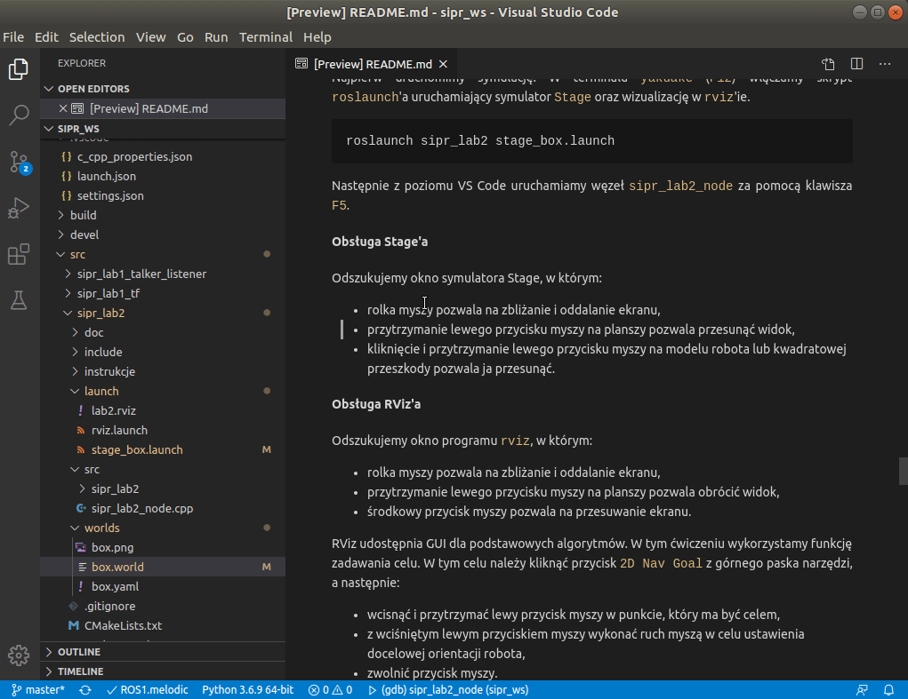
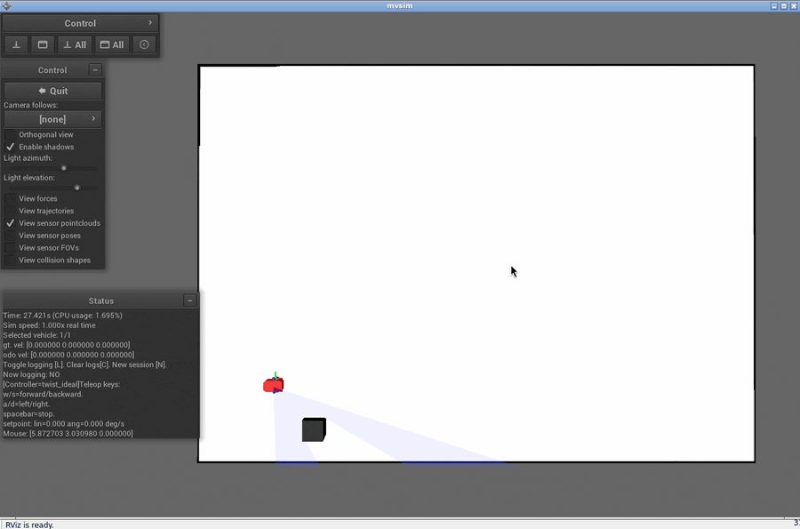
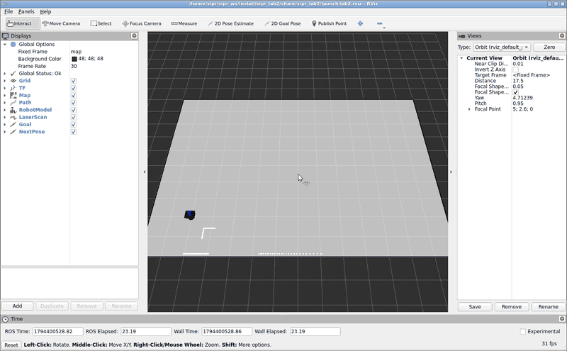
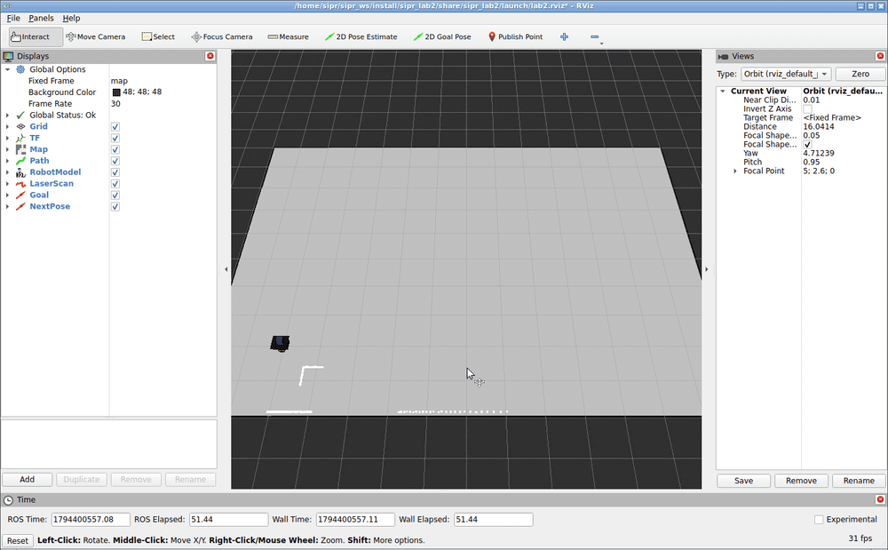
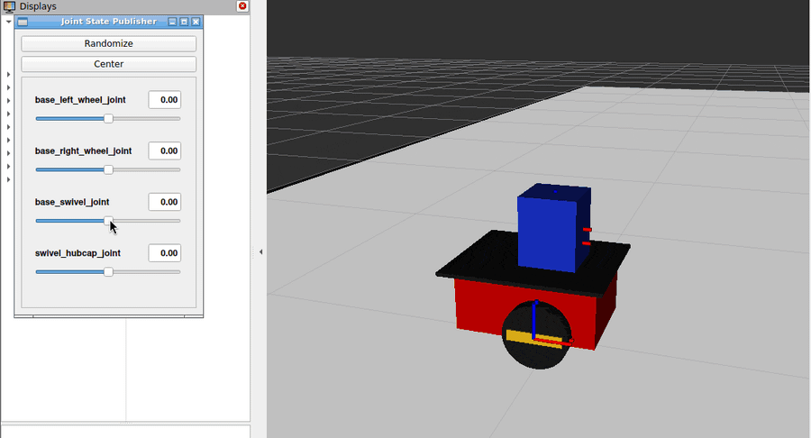

# SiPR – ćwiczenie 2 – Sterowanie robotem o napędzie różnicowym

W ćwiczeniu korzystamy z **ROS 2** w dystrybucji **Lyrical Luth** (Ubuntu 26.04). W porównaniu z wersją ćwiczenia dla ROS 1:

* symulator Stage, niedostępny w ROS 2, zastąpiono symulatorem [MVSim](https://mvsimulator.readthedocs.io),
* model robota Pioneer 3-DX jest częścią pakietu `sipr_lab2` (pakiet `p2os_urdf` nie jest dostępny w ROS 2),
* wizualizacja odbywa się w programie RViz 2, w którym narzędzie *2D Nav Goal* nazywa się *2D Goal Pose*,
* węzeł `sipr_lab2_node` korzysta z biblioteki `rclcpp` – klasa `RobotController` jest węzłem ROS 2 (dziedziczy po `rclcpp::Node`).

## Uwagi do instrukcji

Jeśli zauważysz błąd w instrukcji, wpisz go w terminalu jako komentarz, zaczynając od `#`, np.:

    # UWAGA README.md, konfiguracja debuggera: brak pliku tasks.json

Dzięki znakowi `#` powłoka nie próbuje wykonać tej linii, a uwaga zostaje w historii poleceń.

## Przygotowanie środowiska pracy

Instrukcja zakłada, że wykonane zostało [ćwiczenie 1](https://bitbucket.org/rrgwut/sipr_lab1): istnieje przestrzeń robocza `~/sipr_ws`, ustawiona jest zmienna `ROS_DOMAIN_ID`, a w VS Code zainstalowane jest rozszerzenie C/C++ i utworzone są pliki `.vscode/tasks.json` oraz `.vscode/settings.json`.

### Instalacja brakujących pakietów

Ćwiczenie wymaga symulatora MVSim, pakietów `odom_to_tf_ros2`, `joint_state_publisher_gui` i `xacro` oraz debuggera `gdb`, które powinny być zainstalowane na stanowisku. **Jeśli ich brakuje**, można je doinstalować poleceniami (wciśnij `F12`, aby otworzyć terminal `yakuake`):

```bash
sudo apt update
```

```bash
sudo apt install ros-${ROS_DISTRO}-mvsim ros-${ROS_DISTRO}-odom-to-tf-ros2 ros-${ROS_DISTRO}-joint-state-publisher-gui ros-${ROS_DISTRO}-xacro gdb
```

### Przygotowanie przestrzeni roboczej

Wchodzimy do podkatalogu `src` przestrzeni roboczej `sipr_ws`:

```bash
cd ~/sipr_ws/src
```

Ściągamy kod źródłowy pakietu `sipr_lab2` przygotowanego jako szablon do dalszego wykonania instrukcji:

```bash
git clone https://bitbucket.org/rrgwut/sipr_lab2
```

Budujemy przestrzeń roboczą i ładujemy ją ponownie:

1. Przejdź do katalogu przestrzeni roboczej:

    ```bash
    cd ~/sipr_ws
    ```

2. Zbuduj przestrzeń roboczą w trybie `Debug`, czyli z informacjami potrzebnymi debuggerowi:

    ```bash
    colcon build --symlink-install --cmake-args -DCMAKE_BUILD_TYPE=Debug
    ```

    Tryb budowania zostaje zapamiętany w katalogu `build`, dlatego kolejne budowania (np. skrótem `Ctrl+Shift+B` w VS Code) nie wymagają już opcji `--cmake-args`.

3. Ponieważ powstał nowy pakiet, załaduj przestrzeń roboczą ponownie:

    ```bash
    source ~/sipr_ws/install/setup.bash
    ```

> **Sprawdź:**
>
> ```bash
> ros2 pkg executables sipr_lab2
> ```
>
> Na liście powinien się znaleźć program `sipr_lab2_node`.

### Uruchomienie środowiska VS Code

Uruchamiamy VS Code w przestrzeni roboczej `sipr_ws`. Robimy to z terminala, w którym załadowaliśmy przestrzeń roboczą – programy uruchamiane z VS Code dziedziczą środowisko tego terminala (w tym `ROS_DOMAIN_ID`):

```bash
code ~/sipr_ws
```

W VS Code zobaczymy zawartość całej przestrzeni roboczej `sipr_ws`, w tym otwarte pliki z poprzedniego ćwiczenia, które można zamknąć. W drzewie katalogów można zwinąć katalogi poprzedniego ćwiczenia i rozwinąć katalog `src/sipr_lab2`, w którym znajdziemy tę instrukcję w pliku [`README.md`](./README.md).

#### Konfiguracja debuggera w VS Code

Węzeł `sipr_lab2_node` będziemy uruchamiać z poziomu VS Code pod kontrolą debuggera `gdb`. W katalogu `.vscode` przestrzeni roboczej (tam, gdzie w ćwiczeniu 1 powstały pliki `tasks.json` i `settings.json`) tworzymy plik `launch.json` o treści:

```json
{
  "version": "0.2.0",
  "configurations": [
    {
      "name": "(gdb) sipr_lab2_node",
      "type": "cppdbg",
      "request": "launch",
      "program": "${workspaceFolder}/install/sipr_lab2/lib/sipr_lab2/sipr_lab2_node",
      "args": [],
      "cwd": "${workspaceFolder}",
      "MIMode": "gdb",
      "preLaunchTask": "colcon: build",
      "setupCommands": [
        {
          "description": "Włącz formatowanie wyświetlanych zmiennych",
          "text": "-enable-pretty-printing",
          "ignoreFailures": true
        }
      ]
    }
  ]
}
```

Najważniejsze pola:

* `program` – ścieżka do programu zbudowanego przez `colcon` (w ROS 1 programy trafiały do katalogu `devel/lib`),
* `preLaunchTask` – przed każdym uruchomieniem VS Code buduje przestrzeń roboczą zadaniem `colcon: build` z pliku `tasks.json`, dzięki czemu zawsze uruchamiamy aktualną wersję kodu.

> Jeżeli plik `launch.json` już istnieje, dopisz powyższą konfigurację (fragment w nawiasach `{ }` zaczynający się od `"name"`) do listy `configurations`.



Na koniec możemy sprawdzić, czy węzeł `sipr_lab2_node` – który jest wstępnie zaprogramowany – działa. W tym celu wciskamy `F5` lub przycisk z zieloną strzałką z widoku uruchamiania (`Ctrl+Shift+D`), upewniając się, że na liście rozwijanej wybrana jest opcja `(gdb) sipr_lab2_node`.



Komunikaty węzła pojawiają się u dołu okna VS Code w zakładce *Terminal* (zakładka *Debug Console*, otwierana domyślnie, zawiera komunikaty samego debuggera). Symulacja nie jest jeszcze uruchomiona, więc nie istnieje układ współrzędnych `map` i węzeł `sipr_lab2_node` co 0,1 s wypisuje ostrzeżenie:

```text
[WARN] [...] [sipr_lab2_node]: TF exception:
"map" passed to lookupTransform argument target_frame does not exist. 
```

> Uruchomiony węzeł można zamknąć skrótem klawiszowym `Shift+F5` lub wciskając czerwony kwadrat z panelu debugowania.

## Wprowadzenie teoretyczne (na podstawie wykładu 5)

> **Uwaga:** czytanie instrukcji należy kontynuować z poziomu VS Code, który poprawnie wyświetla wzory (w Bitbucket zamiast wzorów pojawia się kod źródłowy języka LaTeX).
>
> W drzewie katalogów należy:
>
>* odnaleźć i otworzyć plik [`sipr_ws/src/sipr_lab2/README.md`](./README.md),
>* wcisnąć skrót `Ctrl+Shift+P`,
>* rozpocząć pisanie polecenia `markdown preview`
>* i wybrać opcję `Markdown: Open Locked Preview to the Side`.
>
> Edytor z kodem pliku [README.md](./README.md) można zamknąć.
>
> 

### Kinematyka robota mobilnego o napędzie różnicowym

**Pozycję robota (konfigurację)** kołowego poruszającego się po płaskiej powierzchni opisujemy poprzez podanie:

- pozycji punktu $(x, y)$ reprezentującego **środek obrotu robota** (początek układu odniesienia $\{R\}$ robota – baza robota) w zewnętrznym układzie odniesienia $\{W\}$,
- orientacji robota wyrażonej przez kąt $\theta$.


**Prędkość robota w zewnętrznym układzie odniesienia $\{W\}$** oznacza
się jako $\dot{x}, \dot{y}, \dot{\theta}$ (pierwsza pochodna pozycji po
czasie).


$$v_l = \dot{\phi_l} r$$

$$v_r = \dot{\phi_r} r$$

$$R = \frac{b}{2} \frac{v_l + v_r}{v_r - v_l}$$

$$\omega = \frac{v_r - v_l}{b}$$

$$v = \frac{v_l + v_r}{2}$$

$$v = \omega R$$

**Kinematyka prosta prędkości nieholonomicznego robota
kołowego**

$$      \begin{bmatrix}
            \dot{x}      \\
            \dot{y}      \\
            \dot{\theta}
        \end{bmatrix}_W =
        \begin{bmatrix}
            \cos \theta & -\sin\theta & 0 \\
            \sin\theta  & \cos\theta  & 0 \\
            0           & 0           & 1
        \end{bmatrix}
        \begin{bmatrix}
            v      \\
            0      \\
            \omega
        \end{bmatrix}_R =
        \begin{bmatrix}
            v \cos \theta \\
            v \sin \theta \\
            \omega
        \end{bmatrix}$$

**Kinematyka odwrotna prędkości nieholonomicznego robota
kołowego**

$$
        \begin{bmatrix}
            v      \\
            0      \\
            \omega 
        \end{bmatrix}_R =
        \begin{bmatrix}
            \cos \theta & \sin\theta & 0 \\
            -\sin\theta & \cos\theta & 0 \\
            0           & 0          & 1 
        \end{bmatrix}
        \begin{bmatrix}
            \dot{x}      \\
            \dot{y}      \\
            \dot{\theta} 
        \end{bmatrix}_W$$

Dla robota o napędzie różnicowym **prędkości kół lewego i prawego** można
obliczyć ze wzorów:

$$
                \dot{\phi_l} = \frac{v  }{r} - \dfrac{\omega b}{2r}$$

$$
                \dot{\phi_r} = \frac{v }{r} + \dfrac{\omega b}{2r}$$

Z równania odwrotnej kinematyki prędkości, mamy że:

$$
                -\dot{x} \sin \theta + \dot{y} \cos \theta = 0$$

co opisuje **więzy nieholonomiczne** (więzy nałożone na prędkości).

### Algorytmy sterowania dla nieholonomicznego robota kołowego

**Jak osiągnąć zadaną pozycję (konfigurację) $q_g = (x_g,y_g,\theta_g)$ robota znajdującego się w konfiguracji początkowej $q = (x,y,\theta)$?**

Ograniczenia nieholonomiczne sprawiają, że nie ma jednego rozwiązania.

Przykładowa strategia dla robota o napędzie różnicowym:

1. skieruj robota na cel (sterowanie $\omega$ w celu osiągnięcia
    zadanego $\theta$)

2. jedź po prostej (sterowanie $v cos(\theta), v sin(\theta)$ w celu
    osiągnięcia zadanego $(x,y)$)

3. obróć robota w punkcie docelowym do zadanej orientacji (sterowanie
    $\omega$ w celu osiągnięcia zadanego $\theta$)

**Problem ten jest przedmiotem algorytmów planowania i sterowania, w
zależności od przyjętych założeń.**


Jeżeli w otoczeniu robota nie ma przeszkód, można zastosować podstawowe algorytmy sterowania:

- **stabilizacja w punkcie** – celem jest uzyskanie określonego położenia i orientacji docelowej, bez względu na to po jakiej trajektorii robot się porusza,
- **śledzenie trajektorii** – celem jest odtwarzanie zadanej trajektorii; trajektoria jest określona w przestrzeni złączy lub w przestrzeni kartezjańskiej (zadaniowej); znane są pozycje, prędkości i przyspieszenia w funkcji czasu,
- **śledzenie ścieżki** – celem jest pokonanie zadanej ścieżki, przy czym określone są tylko kolejne pozycje, ale nie są narzucone prędkości, ani przyspieszenia; algorytm sterowania sam dobiera odpowiednio prędkości, aby jak najlepiej odtworzyć zadaną ścieżkę.

**Zadanie sterowania** – wyznaczanie przebiegów czasowych wejściowych sygnałów sterujących poszczególnych kół. Sygnałami wejściowymi mogą być:

- **momenty sił** wywierane przez napędy na poszczególne koła,
- **obrót kół o zadany kąt**, gdy napęd jest serwonapędem realizującym
    sterowanie pozycyjne,
- **prędkości obrotowe kół**, gdy układ napędowy realizuje sterowanie
 prędkością – **jest to najczęstszy przypadek w robotach mobilnych**,
- **sygnały napędów**, np. napięcia/prądy wejściowe silników (wymagany model silnika elektrycznego).

#### Algorytm śledzenia trajektorii dla robota mobilnego o napędzie różnicowym (C. Samson, K. Ait-Abderrahim. 1990)

Na rysunku poniżej pokazana jest zadana trajektoria dla dyskretnych chwil $t$ określa pozycję $(x_t, y_t, \theta_t)$ w układzie zewnętrznym oraz prędkość $(v_t, \omega_t)$ w układzie bazy robota. Aktualna pozycja robota oznaczona jest przez $(x,y,\theta)$.


Algorytm sterowania oblicza jaką prędkość należy zadać robotowi $(v_{new}, \omega_{new})$:

$$
    v_{new} = v_t \cos(\theta_t - \theta) + k_1 \big( (x_t - x)\cos(\theta)  + (y_t - y) \sin(\theta) \big)
$$

$$
    \omega_{new} = \omega_t + k_2 \mathrm{sgn}(v_t) \big(-(x_t - x)\sin(\theta) + (y_t - y) \cos(\theta)\big) + k_3 (\theta_t - \theta)
$$

gdzie $k_1, k_2, k_3$ to parametry regulatora, a $\mathrm{sgn}(x)$ to funkcja [signum](https://pl.wikipedia.org/wiki/Funkcja_signum).

Algorytm ten można zapisać także w postaci:

$$
    v_{new} = v_t \cos(\theta_t - \theta)  + k_1 \cdot e_{x,robot} 
$$

$$
    \omega_{new} = \omega_t + k_2 \mathrm{sgn}(v_t) \cdot e_{y,robot} + k_3 \cdot e_{\theta, robot}
$$

gdzie $e_{\cdot,robot}$ to błędy w układzie współrzędnych robota, co pozwala łatwiej zinterpretować znaczenie parametrów regulatora:

- $k_1$ – wzmacnia prędkość liniową, gdy robot znajduje się na trajektorii,
- $k_2$ – wzmacnia prędkość obrotową, gdy robot znajduje się obok trajektorii,
- $k_3$ – wzmacnia prędkość obrotową, gdy zwrot aktualny jest różny od docelowego.

Wynik sterowania według autorów:


#### Algorytm stabilizacji w punkcie dla robota mobilnego o napędzie różnicowym (C. Samson, K. Ait-Abderrahim. 1990)

Przedstawiony tu algorytm śledzenia trajektorii ma również własności stabilizujące pod warunkiem, że co najmniej jedna prędkość, liniowa lub kątowa jest różna od zera.

$$
    v_{new} = v_t \cos(\theta_t - \theta)  + k_1 \cdot e_{x,robot}
$$

$$
    \omega_{new} = \omega_t + k_2 \mathrm{sgn}(v_t) \cdot e_{y,robot} + k_3 \cdot e_{\theta, robot}
$$

Dodając okresową zmianę prędkości postępowej proporcjonalną do $e_{y,robot}$ można wyprowadzić robota z lokalnego minimum.

$$
    v_t = k_{sx} \sin(2 \pi \frac{t}{k_{okres}}) e_{y,robot}
$$

Wynik sterowania według autorów:


## Wykonanie ćwiczenia

Do wykonania są następujące zadania:

1. [Zapoznanie się z możliwościami programów](#1-zapoznanie-się-z-możliwościami-symulacji):

    * MVSim,
    * RViz,
    * `joint_state_publisher_gui`.

2. [Obliczenie prędkości koła lewego i prawego na podstawie prędkości postępowej i obrotowej robota](#2-obliczenie-prędkości-kół).
3. [Zaimplementowanie algorytmu śledzenia trajektorii](#3-implementacja-algorytmu-śledzenia-trajektorii).
4. [Zaimplementowanie algorytmu stabilizacji w punkcie docelowym](#4-implementacja-algorytmu-stabilizacji-w-punkcie).
5. [Dodanie własnego algorytmu unikania kolizji na podstawie danych ze skanera laserowego](#5-implementacja-algorytmu-unikania-kolizji) **(dla chętnych – na ocenę 5.0).**

### 1. Zapoznanie się z możliwościami symulacji

W ramach pakietu `sipr_lab2` przygotowany został węzeł ROS-a o nazwie `sipr_lab2_node` oraz symulacja robota o napędzie różnicowym w symulatorze MVSim.

Najpierw uruchomimy symulację. W terminalu `yakuake` (`F12`) uruchamiamy plik launch, który włącza symulator MVSim, wizualizację w RViz oraz program `joint_state_publisher_gui`:

```bash
ros2 launch sipr_lab2 sim_box.launch.xml
```



> W terminalu pojawi się wiele komunikatów. Komunikaty RViz-a `[ERROR]` o braku pliku `persistent_settings` (przy pierwszym uruchomieniu) oraz o shaderze `indexed_8bit_image` (na części kart graficznych) nie mają wpływu na działanie symulacji.

Plik [`launch/sim_box.launch.xml`](launch/sim_box.launch.xml) uruchamia węzły:

* `mvsim` – symulator: robot Pioneer 3-DX ze skanerem laserowym (kanał `/base_scan`), sterowany prędkością zadawaną na kanale `/cmd_vel`,
* `map_odom` i `ground_truth_tf` – transformacje `map` → `odom` → `base_link`, czyli pozycję robota w symulatorze,
* `robot_state_publisher` – model robota (pliki [`launch/pioneer3dx_urdf.launch.xml`](launch/pioneer3dx_urdf.launch.xml) i [`urdf/pioneer3dx.urdf.xacro`](urdf/pioneer3dx.urdf.xacro)),
* `joint_state_publisher_gui` – położenia złączy robota (kół),
* `rviz2` – wizualizację (plik [`launch/rviz.launch.xml`](launch/rviz.launch.xml) z konfiguracją `launch/lab2.rviz`).

Następnie z poziomu VS Code uruchamiamy węzeł `sipr_lab2_node` za pomocą klawisza `F5`.



> **Sprawdź:** w zakładce *Terminal* VS Code węzeł `sipr_lab2_node` wypisuje:
>
> ```text
> [INFO] [...] [sipr_lab2_node]: Estimated path traversal time: 29.070440
> [INFO] [...] [sipr_lab2_node]: Robot controller state: 0
> ```
>
> i nie pojawiają się kolejne ostrzeżenia `TF exception` (kilka ostrzeżeń zaraz po uruchomieniu jest normalnych).

#### Obsługa symulatora MVSim

Odszukujemy okno symulatora MVSim (tytuł `mvsim`), w którym:

* rolka myszy pozwala na zbliżanie i oddalanie widoku,
* przytrzymanie prawego przycisku myszy na planszy pozwala przesunąć widok,
* przytrzymanie lewego przycisku myszy pozwala obrócić widok (plansza będzie wtedy widoczna pod kątem),
* robota lub kwadratową przeszkodę można przestawić w okienku *Editor*: rozwijamy menu na górze lewego panelu (przycisk `>` obok napisu *Control*) i wybieramy *Editor*, następnie w zakładce *Vehicles* (robot) lub *Blocks* (przeszkoda) zaznaczamy obiekt, klikamy przycisk *Click to replace...* i klikamy w nowe miejsce na planszy.

Okienka *Control*, *Status* i *Editor* można zwinąć przyciskiem `–` w ich prawym górnym rogu.



#### Obsługa RViz

Odszukujemy okno programu RViz, w którym:

* rolka myszy pozwala na zbliżanie i oddalanie widoku,
* przytrzymanie lewego przycisku myszy na planszy pozwala obrócić widok,
* przytrzymanie środkowego przycisku myszy pozwala przesunąć widok.



RViz udostępnia GUI dla podstawowych algorytmów. W tym ćwiczeniu wykorzystamy funkcję zadawania celu. W tym celu należy kliknąć przycisk `2D Goal Pose` z górnego paska narzędzi, a następnie:

* wcisnąć i przytrzymać lewy przycisk myszy w punkcie, który ma być celem,
* z wciśniętym lewym przyciskiem myszy wykonać ruch myszą w celu ustawienia docelowej orientacji robota,
* zwolnić przycisk myszy.



Jeżeli węzeł `sipr_lab2_node` został poprawnie uruchomiony, to po zadaniu punktu docelowego powinny pojawić się:

* cel (strzałka żółta),
* konfiguracja zadana dla danej chwili (czerwona strzałka),
* trajektoria (zielona linia).

Po zaimplementowaniu wszystkich algorytmów, robot powinien podążać za czerwoną strzałką.

> Trajektoria sięga ok. 3 m od celu w każdą stronę, dlatego cel warto wybierać w środkowej części planszy – inaczej trajektoria przetnie ściany.

#### Obsługa `joint_state_publisher_gui`

W tym ćwiczeniu wykorzystamy model robota mobilnego Pioneer 3-DX.

Model robota (plik [`urdf/pioneer3dx.urdf.xacro`](urdf/pioneer3dx.urdf.xacro)) jest częścią pakietu `sipr_lab2`, dzięki czemu robot jest wyświetlany w programie RViz. Ponieważ Pioneer 3-DX jest robotem o napędzie różnicowym, będzie posiadał dwa złącza obrotowe napędu, czyli osie kół lewego (`base_left_wheel_joint`) i prawego (`base_right_wheel_joint`). Program RViz jest w stanie wyświetlać obrót tych złączy (pokazać ruch kół).



Obliczenie położenia koła lewego i prawego w zależności od pokonanej drogi i aktualnej prędkości jest przedmiotem następnego zadania. Jednak, żeby lepiej zrozumieć jaki ma być efekt, możemy ręcznie obracać kołami z poziomu programu `joint_state_publisher_gui`.

> Węzeł `sipr_lab2_node` publikuje obliczone położenia kół na kanale `/wheel_joint_states`, a `joint_state_publisher_gui` przekazuje je dalej w miejsce wartości suwaków – suwaki kół przesuwają się wtedy same. Aby obracać koła ręcznie, zatrzymaj węzeł `sipr_lab2_node` (`Shift+F5` w VS Code).

#### Kod źródłowy pakietu `sipr_lab2`

Węzeł `sipr_lab2_node` zaimplementowany jest w pliku [`src/sipr_lab2_node.cpp`](src/sipr_lab2_node.cpp). Tworzony jest tam obiekt kontrolera ruchu, który jest jednocześnie węzłem ROS-a, a funkcja `rclcpp::spin` obsługuje jego zdarzenia aż do zamknięcia programu.

W pliku `src/sipr_lab2_node.cpp` ([linia 20](src/sipr_lab2_node.cpp#L20)) można w razie potrzeby dostroić niektóre parametry kontrolera (zazwyczaj nie jest to konieczne).

```c++
    // Parametry odtwarzania trajektorii
    config.time_step = 0.1; // sekundy

    config.path_tracking_velocity = 1.0;
    config.path_scale = 3;

    config.pose_tolerance_xy = 0.2;
    config.pose_tolerance_theta = 2.0*M_PI/180.0;
```

Główne zadania kontrolera robota realizowane są przez obiekt `robot_controller` klasy `RobotController` zaimplementowanej w plikach:

* [`include/sipr_lab2/RobotController.h`](include/sipr_lab2/RobotController.h)
* [`src/sipr_lab2/RobotController.cpp`](src/sipr_lab2/RobotController.cpp).

Klasa `RobotController` dziedziczy po klasie `rclcpp::Node`. W jej konstruktorze tworzony jest timer ([`RobotController.cpp` linia 82](src/sipr_lab2/RobotController.cpp#L82)), który co `time_step` sekund wywołuje metodę [`RobotController::control`](src/sipr_lab2/RobotController.cpp#L283), zarządzającą kolejnymi etapami realizacji sterowania. Klasa `RobotController` działa jako prosta maszyna stanów o diagramie pokazanym poniżej.


Zadanie nowego celu z poziomu programu RViz za pomocą narzędzia `2D Goal Pose` powoduje zrestartowanie odtwarzania trajektorii dla nowego celu oraz przejście do stanu `PathTracking`. Każdą zmianę stanu węzeł wypisuje w terminalu jako `Robot controller state: <numer>`, gdzie 0 – `Ready`, 1 – `PathTracking`, 2 – `GoalPositionApproaching`, 3 – `Finished`.

Kolejne zadania wymagają zaimplementowania odpowiednich wzorów matematycznych w metodach klasy `RobotController`:

* [`RobotController::publishJointState`](src/sipr_lab2/RobotController.cpp#L324)
* [`RobotController::pathTrackingControl`](src/sipr_lab2/RobotController.cpp#L343)
* [`RobotController::positionApproachingControl`](src/sipr_lab2/RobotController.cpp#L357)
* [`RobotController::collisionAvoidance`](src/sipr_lab2/RobotController.cpp#L374)

### 2. Obliczenie prędkości kół

W funkcji [`RobotController::publishJointState`](src/sipr_lab2/RobotController.cpp#L324) (plik [`RobotController.cpp` linia 324](src/sipr_lab2/RobotController.cpp#L324)) należy obliczyć prędkości kół lewego i prawego:

```c++
    left_wheel_angular_velocity = ?? ; // rad/s
    right_wheel_angular_velocity = ?? ; // rad/s
```

Do tego potrzebne są promień koła $r$ oraz rozstaw kół $b$ do odczytania ze zmiennych:

* `cfg_.r`
* `cfg_.b`

o wartościach zdefiniowanych w konstruktorze klasy [`RobotController` (linie 49-50)](src/sipr_lab2/RobotController.cpp#L49), a także aktualna prędkość postępowa i obrotowa robota do odczytania z parametru:

* `cmd_vel.linear.x`
* `cmd_vel.angular.z`

> Każdorazowo po modyfikacji kodu należy zatrzymać węzeł (`Shift+F5`) i uruchomić go ponownie klawiszem `F5` – dzięki wpisowi `preLaunchTask` VS Code najpierw zbuduje przestrzeń roboczą. Kod można też skompilować bez uruchamiania, skrótem `Ctrl+Shift+B`; błędy kompilacji pojawią się w zakładce *Problems*.

Efekt obliczenia prędkości zaobserwujemy w RViz dopiero po zaimplementowaniu algorytmu śledzenia trajektorii. W razie stwierdzenia niepoprawnego ruchu kół należy wrócić do tej funkcji i dokonać poprawek.

### 3. Implementacja algorytmu śledzenia trajektorii

W funkcji [`RobotController::pathTrackingControl`](src/sipr_lab2/RobotController.cpp#L343) należy obliczyć prędkości postępową i obrotową:

```c++
    cmd_vel.linear.x = ?;
    cmd_vel.angular.z = ?;
```

Dostępne argumenty to:

* `Pose2D current_pose` – aktualna pozycja robota,
* `Pose2D target_pose` – pozycja zadana dla chwili $t+1$,
* `geometry_msgs::msg::Twist target_vel` – prędkość zadana dla chwili $t+1$, w szczególności:
  * `target_vel.linear.x` – prędkość postępowa [m/s]
  * `target_vel.angular.z` – prędkość obrotowa [rad/s]

Obiekty typu `Pose2D` (struktura zdefiniowana w pliku [`RobotController.h`](include/sipr_lab2/RobotController.h); wiadomość `geometry_msgs/Pose2D` używana w wersji dla ROS 1 została usunięta z ROS 2) mają pola:

* `x` – położenie `X` [m]
* `y` – położenie `Y` [m]
* `theta` – orientacja robota $\theta$ [radiany]

**Uwaga:** gdziekolwiek we wzorach pojawia się różnica kątów $\theta_t - \theta$ należy użyć funkcji `distanceTheta(current_pose, target_pose)`, w przeciwnym wypadku należy samodzielnie zadbać o to, żeby różnica kątów była z przedziału $<-\pi,\pi>$ i reprezentowała najkrótszy obrót między dwiema orientacjami robota.

Potrzebna będzie również funkcja `sgn()`, która oblicza wynik funkcji signum – jest ona zaimplementowana w pliku [`RobotController.cpp` (linia 13)](src/sipr_lab2/RobotController.cpp#L13).

### 4. Implementacja algorytmu stabilizacji w punkcie

W funkcji [`RobotController::positionApproachingControl`](src/sipr_lab2/RobotController.cpp#L357) należy dodać zmienną w czasie modyfikację prędkości postępowej zależną od odległości do celu liczonej w kierunku osi `Y` lokalnego układu współrzędnych robota:

```c++
    starget_control.linear.x = ?;
```

Aktualny czas można odczytać ze zmiennej `time_now` typu `rclcpp::Time`; aby był w sekundach, należy użyć `time_now.seconds()`.

### 5. Implementacja algorytmu unikania kolizji

Ostatnim – dodatkowym – zadaniem jest napisanie prostego algorytmu unikania kolizji bazując na danych ze skanera laserowego. W tym celu należy zmodyfikować kod funkcji [`RobotController::collisionAvoidance`](src/sipr_lab2/RobotController.cpp#L374).

```c++
    geometry_msgs::msg::Twist safe_cmd_vel = cmd_vel;

    for(int i=0; i<int(laser_msg_.ranges.size()); i++)
    {
        //  Ograniczyć prędkość jeżeli spełniony jest warunek
        // if(laser_msg_.ranges[i] < ??)
        // {
        //     safe_cmd_vel.linear.x = ?;
        //     safe_cmd_vel.angular.z = ?;
        // }
    }

    return safe_cmd_vel;
```

Zadanie to wymaga zapoznania się z formatem danych przekazywanych przez skaner laserowy w wiadomości typu `sensor_msgs::msg::LaserScan`, opisanym w dokumentacji: <https://docs.ros.org/en/lyrical/p/sensor_msgs/msg/LaserScan.html>. Opis pól wiadomości można też wyświetlić w terminalu:

```bash
ros2 interface show sensor_msgs/msg/LaserScan
```

Skaner symulowanego robota wykonuje 361 pomiarów co 0,5° w zakresie od -90° (po prawej stronie robota) do +90° (po lewej stronie), a jego zasięg wynosi 8 m – gdy w danym kierunku nie ma przeszkody, odległość wynosi 8.0.

Graficzna interpretacja danych ze skanera laserowego 2D została pokazana na rysunku poniżej (opis różni się minimalnie od nazwy pól w wiadomości typu `sensor_msgs::msg::LaserScan`).


Działanie algorytmu najłatwiej sprawdzić, przestawiając w symulatorze kwadratową przeszkodę na trajektorię robota (okienko *Editor*, zakładka *Blocks* – patrz [Obsługa symulatora MVSim](#obsługa-symulatora-mvsim)).

## Najczęstsze problemy

* `Package 'sipr_lab2' not found` – pakiet nie jest załadowany do środowiska; wykonaj `source ~/sipr_ws/install/setup.bash`.
* `ros2 launch` zgłasza brak pakietu `mvsim`, `odom_to_tf_ros2`, `joint_state_publisher_gui` lub `xacro` – zainstaluj brakujące pakiety (sekcja [Instalacja brakujących pakietów](#instalacja-brakujących-pakietów)).
* Po wciśnięciu `F5` VS Code zgłasza, że nie może znaleźć zadania `colcon: build` – brakuje pliku `.vscode/tasks.json` z ćwiczenia 1 albo zadanie ma w nim inną nazwę (`label`).
* Węzeł `sipr_lab2_node` przez cały czas wypisuje `TF exception: "map" passed to lookupTransform argument target_frame does not exist`, mimo że symulacja działa – VS Code został uruchomiony z terminala z inną wartością `ROS_DOMAIN_ID` niż terminal z symulacją. Zamknij VS Code i uruchom go ponownie poleceniem `code ~/sipr_ws` z terminala, w którym `echo $ROS_DOMAIN_ID` wypisuje numer Twojego stanowiska.
* Debugger nie zatrzymuje się w punktach przerwania (*breakpoint*) – przestrzeń robocza nie została zbudowana w trybie `Debug`; zbuduj ją ponownie poleceniem z sekcji [Przygotowanie przestrzeni roboczej](#przygotowanie-przestrzeni-roboczej).
