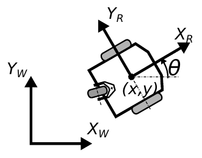
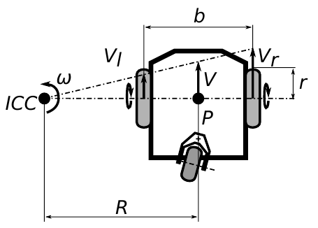
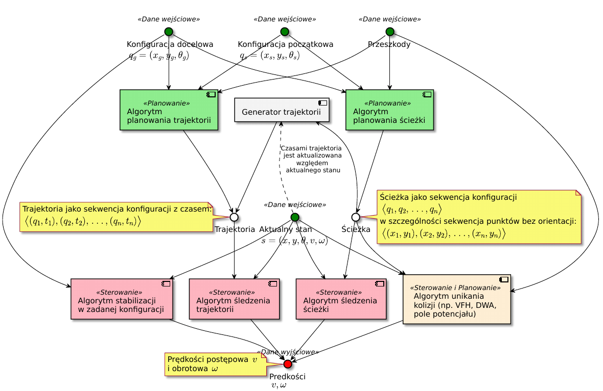
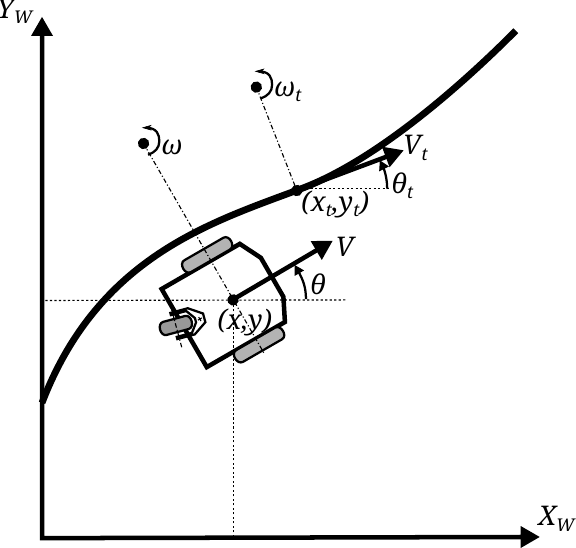
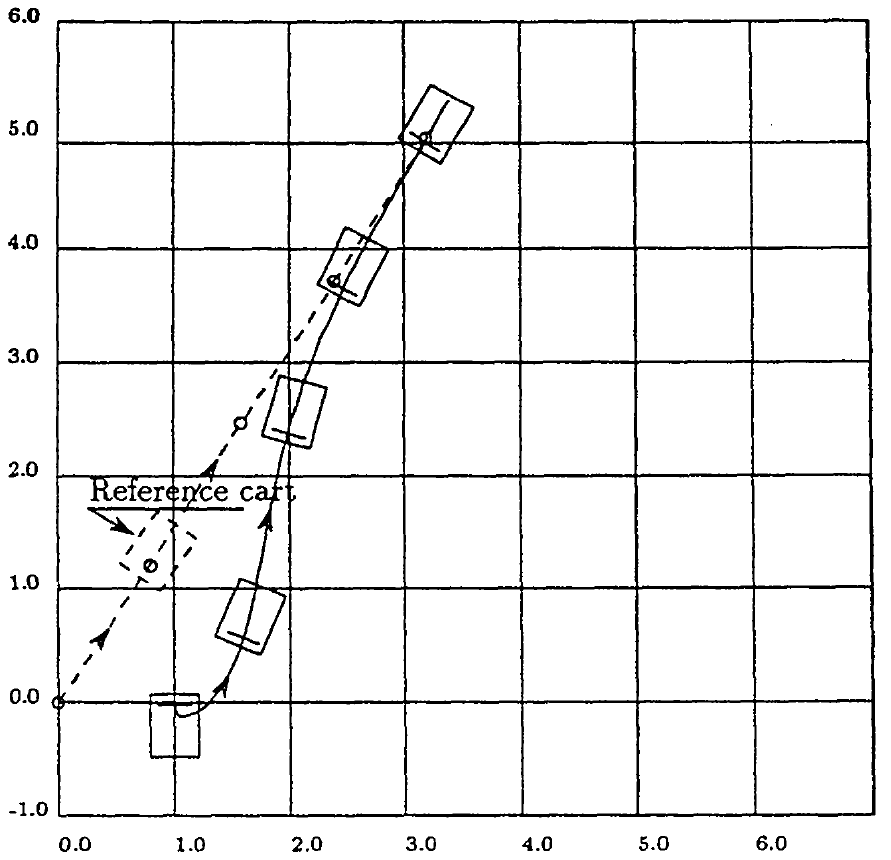
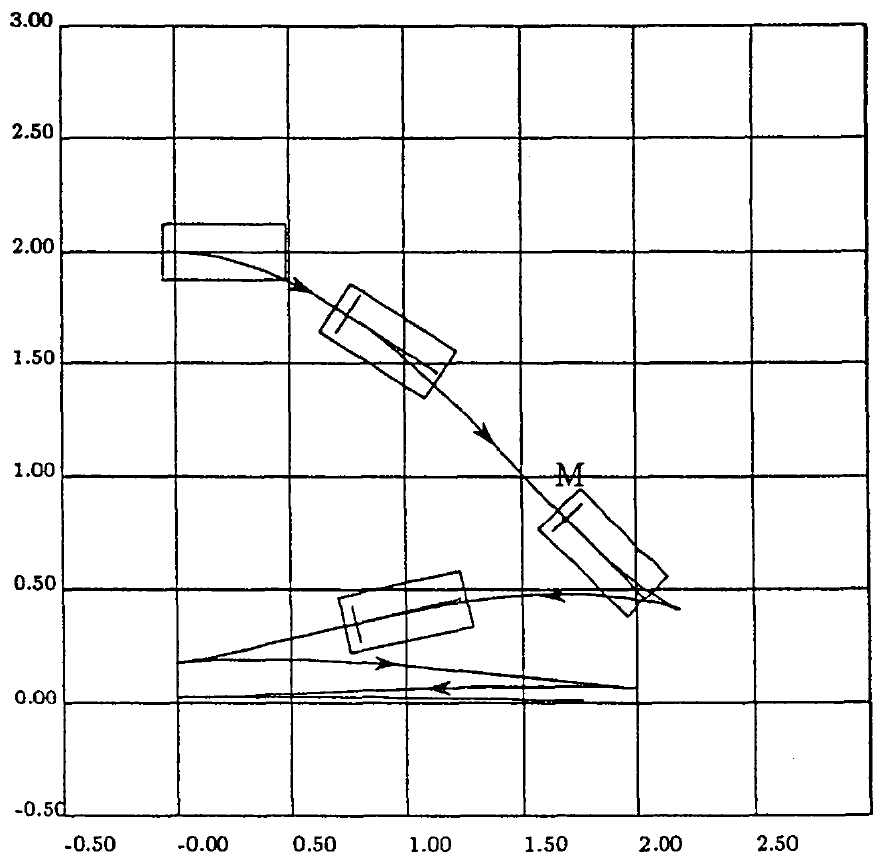
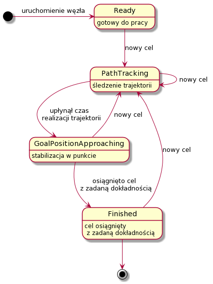
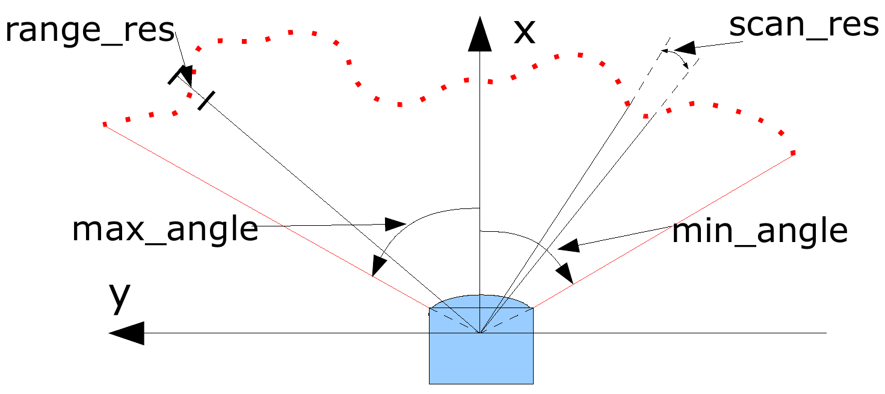

# SiPR – ćwiczenie 2 – Sterowanie robotem o napędzie różnicowym

## Przygotowanie środowiska pracy

Instrukcja przygotowania środowiska pracy zakłada, że wykonane zostało ćwiczenie [Przygotowanie środowiska ROS](https://bitbucket.org/rrgwut/sipr_lab0).

### Instalacja brakujących pakietów

Przed instalacją nowych pakietów z repozytorium Ubuntu należy zainstalować ewentualne aktualizacje. W konsoli `yakuake` (`F12`) wykonujemy polecenia:

```
sudo apt update
```

```
sudo apt upgrade
```

Instalacja brakujących pakietów ROS-a z repozytorium Ubuntu (Ubuntu 18.04, ROS melodic) wymaga uruchomienia w konsoli następującego polecenia (wciśnij `F12`, aby otworzyć terminal `yakuake`):

```
sudo apt install ros-melodic-map-server ros-melodic-stage-ros
```

```
sudo apt install ros-melodic-p2os-urdf ros-melodic-p2os-launch
```

```
sudo apt install ros-melodic-joint-state-publisher-gui
```

### Przygotowanie przestrzeni roboczej

Wchodzimy do podkatalogu `src` przestrzeni roboczej `sipr_ws`:

```
cd ~/sipr_ws/src
```

Ściągamy kod źródłowy pakietu `sipr_lab2` przygotowanego jako szablon do dalszego wykonania instrukcji:

```
git clone https://bitbucket.org/rrgwut/sipr_lab2
```

Wywołujemy budowanie przestrzeni roboczej `sipr_ws`:

```
cd ~/sipr_ws
```

```
catkin_make -DCMAKE_BUILD_TYPE=Debug
```

### Uruchomienie środowiska VS Code

Uruchamiamy VS Code w przestrzeni roboczej `sipr_ws`: 

```
code ~/sipr_ws
```

#### Konfiguracji debuggera w VS Code

W VS Code należy wcisnąć skrót przycisk `Ctrl+Shift+D`, który przeniesienie nas z widoku drzewa katalogów do widoku `Uruchamiania`.

1. Jeżeli debugger **nie był jeszcze konfigurowany** należy wybrać opcję `create a launch.json file`, a dalej opcję `C++ (GDB/LLDB)`.

2. Jeżeli debugger **był już konfigurowany** należy wcisnąć przycisk `Open launch.json` (ten z trybikiem), a następnie w otwartym pliku [`.vscode/launch.json`](`.vscode/launch.json`) kliknąć przycisk `Add configuration...`, który pojawia się w dolnym prawym rogu okna edycji, a następnie wybieramy `C/C++: (gdb) Launch`.

W pliku [`.vscode/launch.json`](`.vscode/launch.json`) zmieniamy następujące linie:

```
...
            "name": "(gdb) sipr_lab2_node",
...
            "program": "${workspaceFolder}/build/sipr_lab2/sipr_lab2_node",
...
```

Na koniec możemy sprawdzić czy węzeł `sipr_lab2_node` – który jest wstępnie zaprogramowany – działa. W tym celu wciskamy `F5` lub przycisk z zieloną strzałką z widoku uruchamiania (`Ctrl+Shift+D`) upewniając się, że na liście rozwijanej wybrana jest opcja `(gdb) sipr_lab2_node`.

W tym momencie nie jest uruchomiony `ROS master`, więc węzeł `sipr_lab2_node` w terminalu (u dołu okna VS Code) pokaże błąd.

> Uruchomiony węzeł można zamknąć skrótem klawiszowym `Shift+F5` lub wciskając czerwony kwadrat z panelu debugowania.

## Wprowadzenie teoretyczne (na podstawie wykładu 5)

> **Uwaga:** czytanie instrukcji należy kontynuować z poziomu VS Code, który poprawnie wyświetla wzory (w Bitbucket zamiast wzorów pojawia się kod źródłowy języka LateX).
>
> W drzewie katalogów należy:
>
>* odnaleźć plik [`sipr_ws/src/sipr_lab2/README.md`](README.md),
>* wcisnąć skrót `Ctrl+Shift+P`,
>* rozpocząć pisanie polecenia `markdown preview`
>* i wybrać opcję `Markdown: Open Locked Preview to the Side`.
>
> Edytor z kodem pliku README.md można zamknąć.

### Kinematyka robota mobilnego o napędzie różnicowym

**Pozycję robota (konfigurację)** kołowego poruszającego się po płaskiej powierzchni opisujemy poprzez podanie:

- pozycji punktu $(x, y)$ reprezentującego **środek obrotu robota** (początek układu odniesienia $\{R\}$ robota – baza robota) w zewnętrznym układzie odniesienia $\{W\}$,
- orientacji robota wyrażonej przez kąt $\theta$.



**Prędkość robota w zewnętrznym układzie odniesienia $\{W\}$** oznacza
się jako $\dot{x}, \dot{y}, \dot{\theta}$ (pierwsza pochodna pozycji po
czasie).



$$v_l = \dot{\phi_l} r$$

$$v_r = \dot{\phi_r} r$$

$$R = \frac{b}{2} \frac{v_l + v_r}{v_r - v_l}$$

$$\omega = \frac{v_r - v_l}{b}$$

$$v = \frac{v_l + v_r}{2}$$

$$v = \omega R$$

**Kinematyka prosta prędkości nieholonomicznego robota
kołowego**

$$      \begin{bmatrix}
            \dot{x}      \\
            \dot{y}      \\
            \dot{\theta}
        \end{bmatrix}_W =
        \begin{bmatrix}
            \cos \theta & -\sin\theta & 0 \\
            \sin\theta  & \cos\theta  & 0 \\
            0           & 0           & 1
        \end{bmatrix}
        \begin{bmatrix}
            v      \\
            0      \\
            \omega
        \end{bmatrix}_R =
        \begin{bmatrix}
            v \cos \theta \\
            v \sin \theta \\
            \omega
        \end{bmatrix}$$

**Kinematyka odwrotna prędkości nieholonomicznego robota
kołowego**

$$
        \begin{bmatrix}
            v      \\
            0      \\
            \omega 
        \end{bmatrix}_R =
        \begin{bmatrix}
            \cos \theta & \sin\theta & 0 \\
            -\sin\theta & \cos\theta & 0 \\
            0           & 0          & 1 
        \end{bmatrix}
        \begin{bmatrix}
            \dot{x}      \\
            \dot{y}      \\
            \dot{\theta} 
        \end{bmatrix}_W$$

Dla robota o napędzie różnicowym **prędkości kół lewego i prawego** można
obliczyć ze wzorów:

$$
                \dot{\phi_l} = \frac{v  }{r} - \dfrac{\omega b}{2r}$$

$$
                \dot{\phi_r} = \frac{v }{r} + \dfrac{\omega b}{2r}$$

Z równania odwrotnej kinematyki prędkości, mamy że:

$$
                -\dot{x} \sin \theta + \dot{y} \cos \theta = 0$$

co opisuje **więzy nieholonomiczne** (więzy nałożone na prędkości).

### Algorytmy sterowania dla nieholonomicznego robota kołowego

**Jak osiągnąć zadaną pozycję (konfigurację) $q_g = (x_g,y_g,\theta_g)$ robota znajdującego się w konfiguracji początkowej $q = (x,y,\theta)$?**

Ograniczenia nieholonomiczne sprawiają, że nie ma jednego rozwiązania.

Przykładowa strategia dla robota o napędzie różnicowym:

1. skieruj robota na cel (sterowanie $\omega$ w celu osiągnięcia
    zadanego $\theta$)

2. jedź po prostej (sterowanie $v cos(\theta), v sin(\theta)$ w celu
    osiągnięcia zadanego $(x,y)$)

3. obróć robota w punkcie docelowym do zadanej orientacji (sterowanie
    $\omega$ w celu osiągnięcia zadanego $\theta$)

**Problem ten jest przedmiotem algorytmów planowania i sterowania, w
zależności od przyjętych założeń.**



Jeżeli w otoczeniu robota nie ma przeszkód, można zastosować podstawowe algorytmy sterowania:

- **stabilizacja w punkcie** – celem jest uzyskanie określonego położenia i orientacji docelowej, bez względu na to po jakiej trajektorii robot się porusza,
- **śledzenie trajektorii** – celem jest odtwarzanie zadanej trajektorii; trajektoria jest określona w przestrzeni złączy lub w przestrzeni kartezjańskiej (zadaniowej); znane są pozycje, prędkości i przyspieszenia w funkcji czasu,
- **śledzenie ścieżki** – celem jest pokonanie zadanej ścieżki, przy czym określone są tylko kolejne pozycje, ale nie są narzucone prędkości, ani przyspieszenia; algorytm sterowania sam dobiera odpowiednio prędkości, aby jak najlepiej odtworzyć zadaną ścieżkę.

**Zadanie sterowania** – wyznaczanie przebiegów czasowych wejściowych sygnałów sterujących poszczególnych kół. Sygnałami wejściowymi mogą być:

- **momenty sił** wywierane przez napędy na poszczególne koła,
- **obrót kół o zadany kąt**, gdy napęd jest serwonapędem realizującym
    sterowanie pozycyjne,
- **prędkości obrotowe kół**, gdy układ napędowy realizuje sterowanie
 prędkością – **jest to najczęstszy przypadek w robotach mobilnych**,
- **sygnały napędów**, np. napięcia/prądy wejściowe silników (wymagany model silnika elektrycznego).

#### Algorytm śledzenia trajektorii dla robota mobilnego o napędzie różnicowym (C. Samson, K. Ait-Abderrahim. 1990)

Na rysunku poniżej pokazana jest zadana trajektoria dla dyskretnych chwil $t$ określa pozycję $(x_t, y_t, \theta_t)$ w układzie zewnętrznym oraz prędkość $(v_y, \omega_t)$ w układzie bazy robota. Aktualna pozycja robota oznaczona jest przez $(x,y,\theta)$.



Algorytm sterowania oblicza jaką prędkość należy zadać robotowi $(v_{new}, \omega_{new})$:

$$
    v_{new} = v_t \cos(\theta_t - \theta) + k_1 \big( (x_t - x)\cos(\theta)  + (y_t - y) \sin(\theta) \big)
$$

$$
    \omega_{new} = \omega_t + k_2 \mathrm{sgn}(v_t) \big(-(x_t - x)\sin(\theta) + (y_t - y) \cos(\theta)\big) + k_3 (\theta_t - \theta)
$$

gdzie $k_1, k_2, k_3$ to parametry regulatora, a $\mathrm{sgn}(x)$ to funkcja [signum](https://pl.wikipedia.org/wiki/Funkcja_signum).

Algorytm ten można zapisać także w postaci:

$$
    v_{new} = v_t \cos(\theta_t - \theta)  + k_1 \cdot e_{x,robot} 
$$

$$
    \omega_{new} = \omega_t + k_2 \mathrm{sgn}(v_t) \cdot e_{y,robot} + k_3 \cdot e_{\theta, robot}
$$

gdzie $e_{\cdot,robot}$ to błędy w układzie współrzędnych robota, co pozwala łatwiej zinterpretować znaczenie parametrów regulatora:

- $k_1$ – wzmacnia prędkość liniową, gdy robot znajduje się na trajektorii,
- $k_2$ – wzmacnia prędkość obrotową, gdy robot znajduje się obok trajektorii,
- $k_3$ – wzmacnia prędkość obrotową, gdy zwrot aktualny jest różny od docelowego.

Wynik sterowania według autorów:



#### Algorytm stabilizacji w punkcie dla robota mobilnego o napędzie różnicowym (C. Samson, K. Ait-Abderrahim. 1990)

Przedstawiony tu algorytm śledzenia trajektorii ma również własności stabilizujące pod warunkiem, że co najmniej jedna prędkość, liniowa lub kątowa jest różna od zera.

$$
    v_{new} = v_t \cos(\theta_t - \theta)  + k_1 \cdot e_{x,robot}
$$

$$
    \omega_{new} = \omega_t + k_2 \mathrm{sgn}(v_t) \cdot e_{y,robot} + k_3 \cdot e_{\theta, robot}
$$

Dodając okresową zmianę prędkości postępowej proporcjonalną do $e_{y,robot}$ można wyprowadzić robota z lokalnego minimum.

$$
    v_t = k_{sx} \sin(2 \pi \frac{t}{k_{okres}}) e_{y,robot}
$$

Wynik sterowania według autorów:



## Wykonanie ćwiczenia

Do wykonania są następujące zadania:

1. [Zapoznanie się z możliwościami programów](#-1.-zapoznanie-się-z-możliwościami-symulacji):

    * Stage,
    * `rviz`,
    * `joint_state_publisher_gui`.

2. [Obliczenie prędkości koła lewego i prawego na podstawie prędkości postępowej i obrotowej robota](#-2.-obliczenie-prędkości-kół).
3. [Zaimplementowanie algorytmu śledzenia trajektorii](#-3.-implementacja-algorytmu-śledzenia-trajektorii).
4. [Zaimplementowanie algorytmu stabilizacji w punkcie docelowym](#-4.-implementacja-algorytmu-stabilizacji-w-punkcie).
5. [Dodanie własnego algorytmu unikania kolizji na podstawie danych ze skanera laserowego](#-5.-implementacja-algorytmu-unikania-kolizji) **(dla chętnych – na ocenę 5.0).**

### 1. Zapoznanie się z możliwościami symulacji

W ramach pakietu `sipr_lab2` przygotowany został węzeł ROS-a o nazwie `sipr_lab2_node` oraz symulacja robota o napędzie różnicowym w symulatorze Stage.

Najpierw uruchomimy symulację. W terminalu `yakuake` (`F12`) włączamy skrypt `roslaunch`'a uruchamiający symulator `Stage` oraz wizualizację w `rviz`'ie.

```
roslaunch sipr_lab2 stage_box.launch
```

Następnie z poziomu VS Code uruchamiamy węzeł `sipr_lab2_node` za pomocą klawisza `F5`.

#### Obsługa Stage'a

Odszukujemy okno symulatora Stage, w którym:

* rolka myszy pozwala na zbliżanie i oddalanie ekranu,
* przytrzymanie lewego przycisku myszy na planszy pozwala przesunąć widok,
* kliknięcie i przytrzymanie lewego przycisku myszy na modelu robota lub kwadratowej przeszkody pozwala ja przesunąć.

#### Obsługa RViz'a

Odszukujemy okno programu `rviz`, w którym:

* rolka myszy pozwala na zbliżanie i oddalanie ekranu,
* przytrzymanie lewego przycisku myszy na planszy pozwala obrócić widok,
* środkowy przycisk myszy pozwala na przesuwanie ekranu.

RViz udostępnia GUI dla podstawowych algorytmów. W tym ćwiczeniu wykorzystamy funkcję zadawania celu. W tym celu należy kliknąć przycisk `2D Nav Goal` z górnego paska narzędzi, a następnie:

* wcisnąć i przytrzymać lewy przycisk myszy w punkcie, który ma być celem,
* z wciśniętym lewym przyciskiem myszy wykonać ruch myszą w celu ustawienia docelowej orientacji robota,
* zwolnić przycisk myszy.

Jeżeli węzeł `sipr_lab2_node` został poprawnie uruchomiony, to po zadaniu punktu docelowego powinny pojawić się:

* cel (strzałka żółta),
* konfiguracja zadana dla danej chwili (czerwona strzałka),
* trajektoria (zielona linia).

Po zaimplementowaniu wszystkich algorytmów, robot powinien podążąć za czerwoną strzałką.

#### Obsługa `joint_state_publisher_gui`

W tym ćwiczeniu wykorzystamy model robota mobilnego Pioneer 3dx.

W pakiecie `p2os_urdf` (zainstalowaliśmy go za pomocą `apt`) znajduje się model tego robota (plik `urdf`), dzięki czemu robot jest wyświetlany w programie `rviz`. Ponieważ Pioneer 3dx jest robotem o napędzie różnicowym, będzie posiadał dwa złącza obrotowe, czyli osie kół lewego i prawego. Program `rviz` jest w stanie wyświetlać obrót tych złączy (pokazać ruch kół).

Obliczenie położenia koła lewego i prawego w zależności od pokonanej drogi i aktualnej prędkości jest przedmiotem następnego zadania. Jednak, żeby lepiej zrozumieć jaki ma być efekt możemy ręcznie obracać kołami z poziomu programu `joint_state_publisher_gui`.

#### Kod źródłowy pakietu `sipr_lab2`

Węzeł `sipr_lab2_node` zaimplementowany jest w pliku [`src/sipr_lab2_node.cpp`](src/sipr_lab2_node.cpp). Znajduje się tam główna pętla programu. 

W pliku `src/sipr_lab2_node.cpp` ([linia 21](src/sipr_lab2_node.cpp#L21)) można w razie potrzeby dostroić niektóre parametry kontrolera (zazwyczaj nie jest to konieczne).

```c++
    // Parametry odtwarzania trajektorii
    config.time_step = 0.1; // sekundy

    config.path_tracking_velocity = 1.0;
    config.path_scale = 3;

    config.pose_tolerance_xy = 0.2;
    config.pose_tolerance_theta = 2.0*M_PI/180.0;
```

Główne zadania kontrolera robota realizowane są przez obiekt `robot_controller` klasy `RobotController` zaimplementowanej w plikach:

* [`include/sipr_lab2/RobotController.h`](include/sipr_lab2/RobotController.h)
* [`src/sipr_lab2/RobotController.cpp`](src/sipr_lab2/RobotController.cpp).

W każdym obrocie głównej pętli programu `sipr_lab2_node` ([`sipr_lab2_node.cpp` linia 42](src/sipr_lab2_node.cpp#L42)) wywoływana jest mteoda [`RobotController::control`](src/sipr_lab2/RobotController.cpp#L259), która zarządza kolejnymi etapami realizacji sterowania. Klasa `RobotController` działa jako prosta maszyna stanów o diagramie pokazanym poniżej.



Zadanie nowego celu z poziomu programu `rviz` za pomocą funkcji `2D Nav Goal` powoduje zrestartowanie odtwarzanie trajektorii dla nowego celu oraz przejście do stanu `PathTracking`.

Kolejne zadania wymagają zaimplementowania odpowiednich wzorów matematycznych w metodach klasy `RobotController`:

* [`RobotController::publishJointState`](src/sipr_lab2/RobotController.cpp#L300)
* [`RobotController::pathTrackingControl`](src/sipr_lab2/RobotController.cpp#L318)
* [`RobotController::positionApproachingControl`](src/sipr_lab2/RobotController.cpp#L332)
* [`RobotController::collisionAvoidance`](src/sipr_lab2/RobotController.cpp#L349)

### 2. Obliczenie prędkości kół

W funkcji [`RobotController::publishJointState`](src/sipr_lab2/RobotController.cpp#L300) (plik [`RobotController.cpp` linia 300](src/sipr_lab2/RobotController.cpp#L300)) należy obliczyć prędkości kół lewego i prawego:

```c++
    left_wheel_angular_velocity = ?? ; // rad/s
    right_wheel_angular_velocity = ?? ; // rad/s
```

Do tego potrzebne jest promień koła $r$ oraz rozstaw kół $b$ do odczytania ze zmiennych:

* `cfg_.r`
* `cfg_.b`

o wartościach zdefiniowanych w konstruktorze klasy [`RobotController` (linie 38-39)](src/sipr_lab2/RobotController.cpp#L38), a także aktualna prędkość postępowa i obrotowa robota do odczytania z parametru:

* `cmd_vel.linear.x`
* `cmd_vel.angular.z`

> Każdorazowo po modyfikacji kodu należy pamiętać o kompilacji za pomocą skrótu `Ctrl+Shift+B` w VS Code.

Efekt obliczenia prędkości zaobserwujemy w `rviz` dopiero po zaimplementowaniu algorytmu śledzenia trajektorii. W razie stwierdzenia niepoprawnego ruchu kół należy wrócić do tej funkcji i dokonać poprawek.

### 3. Implementacja algorytmu śledzenia trajektorii

W funkcji [`RobotController::pathTrackingControl`](src/sipr_lab2/RobotController.cpp#L318) należy obliczyć prędkości postępową i obrotową:

```c++
    cmd_vel.linear.x = ?;
    cmd_vel.angular.z = ?;
```

Dostępne argumenty to: 

* `geometry_msgs::Pose2D current_pose` – aktualna pozycja robota,
* `geometry_msgs::Pose2D target_pose` – pozycja zadana dla chwili $t+1$,
* `geometry_msgs::Twist target_vel` – prędkość zadana dla chwili $t+1$, w szczególności:
  * `target_vel.linear.x` – prędkość postępowa [m/s]
  * `target_vel.angular.z` – prędkość obrotowa [rad/s]

Obiekty typu `geometry_msgs::Pose2D` mają pola:

* `x` – położenie `X` [m]
* `y` – położenie `Y` [m]
* `theta` – orientacja robota $\theta$ [radiany]

**Uwaga:** gdziekolwiek we wzorach pojawia się różnica kątów $\theta_t - \theta$ należy użyć funkcji `distanceTheta(current_pose, target_pose)`, w przeciwnym wypadku należy samodzielnie zadbać o to, żeby różnica kątów była z przedziału $<-\pi,\pi>$ i reprezentowała najkrótszy obrót między dwiema orientacjami robota.

Potrzebna będzie również funkcja `double sgn(double)`, które oblicza wynik funkcji signum.

### 4. Implementacja algorytmu stabilizacji w punkcie

W funkcji [`RobotController::positionApproachingControl`](src/sipr_lab2/RobotController.cpp#L332) należy dodać zmienną w czasie modyfikację prędkości postępowej zależną od odległości do celu liczonej w kierunku osi `Y` lokalnego układu współrzędnych robota:

```c++
    starget_control.linear.x = ?;
```

Aktualny czas można odczytać ze zmiennej `time_now`, aby był w sekundach należy użyć `time_now.toSec()`.

### 5. Implementacja algorytmu unikania kolizji

Ostatnim – dodatkowym – zadaniem jest napisanie prostego algorytmu unikania kolizji bazując na danych ze skanera laserowego. W tym celu należy zmodyfikować kod funkcji [`RobotController::collisionAvoidance`](src/sipr_lab2/RobotController.cpp#L349). 

```c++
    geometry_msgs::Twist safe_cmd_vel = cmd_vel;

    for(int i=0; i<int(laser_msg_.ranges.size()); i++)
    {
        //  Ograniczyć prędkość jeżeli spełniony jest warunek
        // if(laser_msg_.ranges[i] < ??)
        // {
        //     safe_cmd_vel.linear.x = ?;
        //     safe_cmd_vel.angular.z = ?;
        // }
    }

    return safe_cmd_vel;
```

Zadanie to wymaga zapoznania się z dokumentacją formatu danych przekazywanych przez skaner laserowy w wiadomości typu `sensor_msgs::LaserScan` dostępnej pod adresem <https://docs.ros.org/api/sensor_msgs/html/msg/LaserScan.html>.

Graficzna interpretacja danych ze skanera laserowego 2D została pokazana na rysunku poniżej (opis różni się minimalnie od nazwy pól w wiadomości typu `sensor_msgs::LaserScan`).


